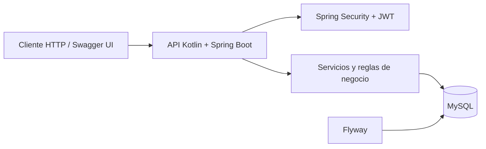
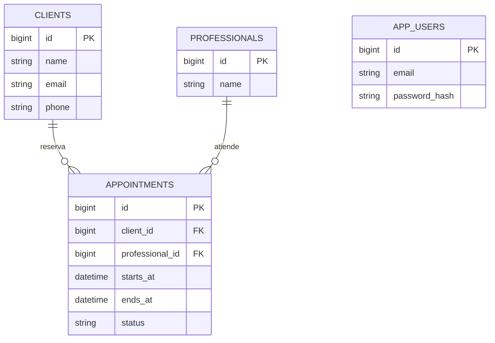

# Gestor de citas para negocios

API REST para que un negocio administre sus clientes, profesionales y reservas, evitando citas superpuestas. Proyecto de portafolio construido con **Kotlin, Spring Boot, Spring Security, JWT, MySQL, Flyway y Docker**.

## Funcionalidades y reglas

- Un administrador inicia sesión y recibe un JWT válido durante una hora; la contraseña se almacena con BCrypt.
- Crear, consultar y actualizar clientes y profesionales.
- Agendar, consultar por día, reprogramar y cancelar citas.
- Las citas deben comenzar en el futuro y finalizar después de su inicio. Dos citas activas de un mismo profesional no pueden superponerse; sí pueden ser consecutivas.
- Al reprogramar se conservan el ID, el cliente y el profesional. Se permite mantener el mismo horario si sigue siendo futuro. Una cita cancelada no se puede reprogramar; cancelarla de nuevo devuelve la misma cita cancelada.
- Se serializan las operaciones de reserva para un mismo profesional, incluso con solicitudes concurrentes. Flyway crea el esquema y Docker conserva los datos en un volumen.

El alcance actual corresponde a **un solo negocio y un administrador inicial**. No incluye registro público, recuperación de contraseña, roles, gestión de horarios laborales ni separación entre negocios.

## Arquitectura y datos





El código de clientes, profesionales, citas, seguridad y errores está separado por responsabilidad en `src/main/kotlin/com/portafolio/citas`. Las migraciones están en `src/main/resources/db/migration`.

## Requisitos

- Docker Desktop iniciado con Docker Compose y conexión a internet para la primera descarga.
- Opcional para desarrollo fuera de Docker: JDK 21. Se incluye Gradle Wrapper; no es necesario instalar Gradle.

## Iniciar en Windows

Desde PowerShell en la carpeta del proyecto, si todavía no existe `.env`, créalo a partir del ejemplo:

```powershell
Copy-Item .env.example .env
```

Edita `.env` y configura contraseñas y `JWT_SECRET` antes de continuar. La clave JWT debe tener al menos 32 bytes y la contraseña del administrador al menos 12 caracteres. No publiques `.env`.

```powershell
docker compose up --build -d
docker compose logs -f api
```

Cuando la aplicación inicie, abre <http://localhost:8080/swagger-ui/index.html>. MySQL queda accesible localmente por el puerto `3307` y la API por el `8080`. El documento OpenAPI está en <http://localhost:8080/v3/api-docs>.

Para detener los servicios sin borrar los datos:

```powershell
docker compose down
```

El administrador se crea solo si la tabla de usuarios está vacía: modificar `ADMIN_EMAIL` o `ADMIN_PASSWORD` después no actualiza ese usuario. Las credenciales iniciales de MySQL también se aplican solo cuando el volumen está vacío. `docker compose down -v` elimina el volumen y **todos los datos**.

## Operaciones principales

Todas requieren token Bearer excepto el inicio de sesión.

| Método | Ruta | Función |
| --- | --- | --- |
| POST | `/api/auth/login` | Iniciar sesión |
| POST, GET | `/api/clients` | Crear o listar clientes |
| GET, PUT | `/api/clients/{id}` | Consultar o reemplazar los datos de un cliente |
| POST, GET | `/api/professionals` | Crear o listar profesionales |
| GET, PUT | `/api/professionals/{id}` | Consultar o actualizar un profesional |
| POST, GET | `/api/appointments` | Crear o listar citas; admite `?date=2099-05-01` |
| GET | `/api/appointments/{id}` | Consultar una cita |
| PATCH | `/api/appointments/{id}/reschedule` | Reprogramar una cita activa |
| PATCH | `/api/appointments/{id}/cancel` | Cancelar una cita |

En los `PUT` se reemplazan los datos completos: los campos opcionales del cliente que se omitan quedan vacíos.

## Ejemplo con Swagger

1. En Swagger ejecuta `POST /api/auth/login` con el correo y contraseña de `.env`.
2. Copia `accessToken`, pulsa **Authorize** y pégalo sin el prefijo `Bearer`.
3. Crea un cliente con `{"name":"Ana Pérez","email":"ana@example.com"}` y un profesional con `{"name":"Laura Gómez"}`.
4. Con los ID devueltos, crea una cita usando una fecha futura:

   ```json
   {"clientId":1,"professionalId":1,"startsAt":"2099-05-01T15:00:00","endsAt":"2099-05-01T16:00:00"}
   ```

5. Para reprogramarla, utiliza `PATCH /api/appointments/{id}/reschedule`:

   ```json
   {"startsAt":"2099-05-01T16:00:00","endsAt":"2099-05-01T17:00:00"}
   ```

Las fechas son `LocalDateTime` sin sufijo de zona y se interpretan siempre como **UTC**. Para Colombia, suma cinco horas a la hora local antes de enviarla. El filtro por fecha también utiliza el día UTC y selecciona las citas que comienzan ese día.

La API devuelve `201` al crear, `400` por datos inválidos, `401` por falta de autenticación o credenciales incorrectas, `404` si no existe el recurso y `409` por conflicto de horario o al reprogramar una cita cancelada. Los errores de la aplicación usan el formato Problem Details, por ejemplo:

```json
{"type":"about:blank","title":"Conflict","status":409,"detail":"El profesional ya tiene una cita en ese horario"}
```

## Pruebas

Pruebas de API con H2 en memoria:

```powershell
.\gradlew.bat test
```

Para incluir la prueba de concurrencia con **MySQL real**, levanta una base temporal e independiente; no se conecta a la base habitual de la aplicación:

```powershell
docker compose -p gestor-citas-tests -f compose.test.yaml up -d --wait
$env:MYSQL_TEST_URL = 'jdbc:mysql://localhost:3308/citas_test?serverTimezone=UTC'
.\gradlew.bat test
Remove-Item Env:MYSQL_TEST_URL
docker compose -p gestor-citas-tests -f compose.test.yaml down
```

Esta base de pruebas utiliza el puerto `3308` y credenciales exclusivamente de prueba; sus datos desaparecen al eliminar el contenedor. Sin `MYSQL_TEST_URL`, la prueba de MySQL se omite. GitHub Actions configura automáticamente una base temporal y ejecuta ambas pruebas al subir cambios o abrir un pull request.
